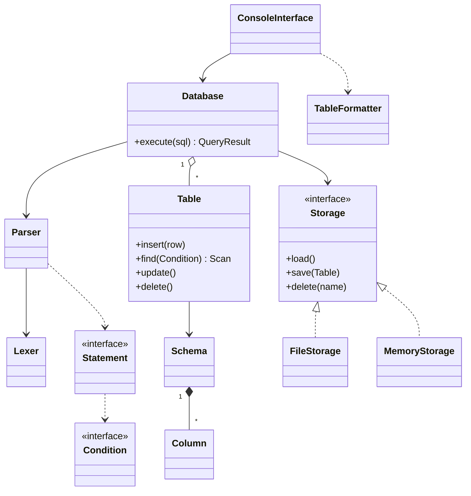
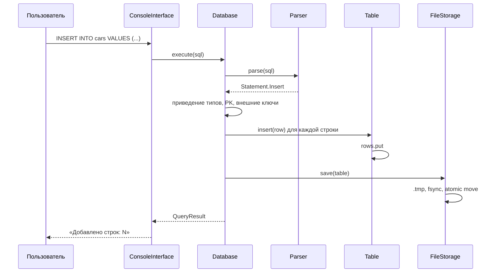

# СУБД на Java

Консольная реляционная СУБД с SQL-запросами, типами данных, ключами и хранением таблиц в файлах.

Проект выполнен в рамках практической работы 2.

## Возможности

- Таблицы с типами `INT`, `DOUBLE`, `STRING`, `DATE`, `BOOLEAN`.
- Запросы `CREATE TABLE`, `DROP TABLE`, `INSERT`, `SELECT`, `UPDATE`, `DELETE`.
- Первичный и внешние ключи с проверкой ограничений.
- Условия `WHERE` с операторами сравнения, `AND` и `OR`.
- Хранение таблиц в бинарных файлах с атомарной записью.
- Консоль с многострочными запросами и справкой.

## Установка и запуск


**Требования:** JDK 25 и Maven. Из каталога `practice-2`:

```sh
mvn test
java -cp target/classes db.Main            # данные в ./data
java -cp target/classes db.Main my-data    # другой каталог данных
java -cp target/classes db.Main < examples/demo.sql
```

Консольные команды:

| Команда        | Назначение                |
| -------------- | ------------------------- |
| `help`         | Показать примеры запросов |
| `exit`, `quit` | Завершить работу          |

Запрос заканчивается `;` и может занимать несколько строк.
Ключевые слова не зависят от регистра, имена таблиц и колонок приводятся к нижнему регистру.

### Примеры запросов

```sql
CREATE TABLE cars (id INT PRIMARY KEY, brand STRING, price DOUBLE, since DATE, used BOOLEAN);
CREATE TABLE owners (id INT PRIMARY KEY, car_id INT REFERENCES cars(id), name STRING);
INSERT INTO cars VALUES (1, 'Toyota', 25000.0, '2020-05-17', TRUE), (2, 'BMW', 40000, '2021-01-01', FALSE);
INSERT INTO cars (id, brand) VALUES (3, 'Kia');
SELECT brand, price FROM cars WHERE price > 20000 AND used = TRUE;
UPDATE cars SET price = 30000 WHERE id = 2;
DELETE FROM cars WHERE brand = 'Toyota';
DROP TABLE owners;
```

### Правила

- В таблице ровно один `PRIMARY KEY`, он уникален, не `NULL` и не меняется через `UPDATE`.
- `REFERENCES t(c)` — внешний ключ на первичный ключ другой таблицы.
- Литерал даты — строка `'ГГГГ-ММ-ДД'`; целое допустимо для DOUBLE.
- WHERE: `= != <> < <= > >=`, `AND`, `OR` (AND сильнее), без скобок. Сравнение с `NULL` ложно.
- `INSERT` с несколькими кортежами атомарен: при ошибке не добавляется ничего.
- Порядок строк без ORDER BY не гарантируется.

## Архитектура



Применённые шаблоны: **Repository** (`Storage` скрывает способ хранения от `Database`),
**Iterator** (`Table` реализует `Iterable`), **Interpreter** (запрос разбирается `Parser` в объекты `Statement` и `Condition`,
а `Database` их выполняет).

### Выполнение запроса



## Хранение и восстановление

Каталог данных содержит по файлу `<таблица>.tbl` (схема и строки) в бинарном формате через
`DataOutputStream`; таблицы загружаются при запуске.

- После каждого изменяющего запроса таблица записывается целиком. Файл пишется во временный `.tmp`,
  сбрасывается на диск (`fsync`) и атомарно переименовывается, поэтому после сбоя остаётся старая или
  новая версия файла. Недописанные `.tmp` удаляются при старте.
- Повреждённый файл таблицы приводит к ошибке запуска.
- Ограничение: сохранение переписывает таблицу целиком, это O(размер таблицы) на запрос.

## Тесты и проверки

Запуск: `mvn test`. Тесты разбора запросов, ограничений и операций `Database`, перезапуска с диска, остатков `.tmp`
и консоли.

## Что ещё не сделано

- Индексы (`CREATE INDEX`), их хранение на диске и ускорение SELECT, UPDATE, DELETE.
- Замеры производительности с индексом и без.
- Раздел об ответственности участников, выводы.

## Источники

1. Oracle. Java SE 25 API: `java.io.DataOutputStream`, `java.nio.file.Files.move` (`ATOMIC_MOVE`).
2. Silberschatz A., Korth H., Sudarshan S. Database System Concepts. McGraw-Hill.
3. Fowler M. Patterns of Enterprise Application Architecture (Repository). Addison-Wesley, 2002.
4. Gamma E. et al. Design Patterns (Iterator, Interpreter). Addison-Wesley, 1994.
5. JUnit 5 User Guide, https://junit.org/junit5/docs/current/user-guide/
